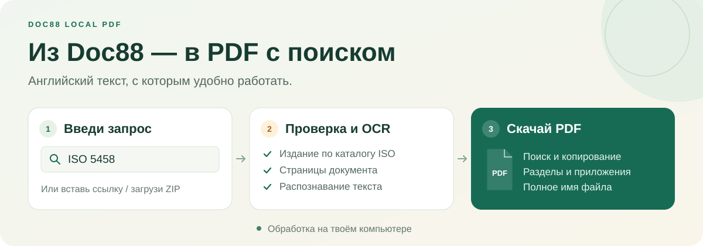

# 📄 Doc88 Local PDF

**Найди документ → получи PDF, в котором можно искать, выделять и копировать текст.**

Программа превращает страницы Doc88 в один PDF с распознанным английским текстом. Работает на твоём компьютере, управление — в браузере.

  

### [⬇️ Скачать программу для Windows](https://github.com/decli-dot/doc88-local-pdf/releases/latest/download/doc88-local-pdf-v1.8.0.zip)

[Что нового](https://github.com/decli-dot/doc88-local-pdf/releases/latest) · [Подробная инструкция](docs/GUIDE.md) · [Сообщить о проблеме](https://github.com/decli-dot/doc88-local-pdf/issues)

## 🚀 Первый запуск — 4 шага

1. Установи **[Node.js 24](https://nodejs.org/en/download)** — он нужен для работы программы.
2. **[Скачай ZIP](https://github.com/decli-dot/doc88-local-pdf/releases/latest/download/doc88-local-pdf-v1.8.0.zip)** и распакуй его в отдельную папку.
3. Открой **`Setup.cmd`** и дождись установки.
4. Открой **`Start.cmd`** — программа появится в браузере.

Нужен установленный **Edge или Chrome**. Отдельно устанавливать OCR не требуется. При первом распознавании программа скачает английскую языковую модель.

## 🔎 Как получить документ

1. Открой вкладку **«Найти документ»** и введи, например, **`ISO 5458`**.
2. Нажми **«Найти и проверить»**. Программа уточнит издание по каталогу ISO, найдёт варианты на Doc88 и проверит их.
3. Когда обработка закончится, нажми **«Скачать OCR PDF»**.

Можно также **вставить ссылку Doc88**, **загрузить ZIP со страницами** или добавить **до 30 запросов списком**.

💡 Год можно не писать. Если указанный год не подтверждается, программа предложит выбрать издание. Если Doc88 покажет капчу, пройди её вручную в панели рядом с результатом.

## ✨ Что умеет программа

| Возможность                  | Что ты получишь                                                                                    |
| :--------------------------- | :------------------------------------------------------------------------------------------------- |
| 🔎 **Поиск ISO**             | Проверка издания и полное официальное название файла. Без подмены на EN, BS EN или DIN EN ISO.     |
| 📑 **Проверка страниц**      | Сверка количества страниц с ISO и Doc88, поиск точных повторов и явных пропусков нумерации.        |
| 🔍 **Подготовка к OCR**      | Увеличение мелких и размытых страниц перед распознаванием. Исходные картинки сохраняются отдельно. |
| 🌿 **Структура PDF**         | Переходы к разделам, подразделам, приложениям и библиографии.                                      |
| 🔗 **Связанные документы**   | Поиск выбранных нормативных ссылок и отдельных поправок.                                           |
| ⏯️ **Очередь и продолжение** | Обработка списка, продолжение после сбоя и ZIP с готовыми PDF.                                     |

Распознавание настроено на **английский** и выполняется **на твоём компьютере**. Если язык или нумерацию не удалось уверенно проверить, программа покажет заметку. OCR и автоматическая проверка могут ошибаться — особенно на плохих сканах.

## 🔄 Как обновить

Закрой программу → распакуй новый ZIP с заменой файлов → снова открой **`Setup.cmd`**, затем **`Start.cmd`**.

**Сохрани папку `.data`**: в ней история, документы и данные для продолжения задач.

## 📚 Если нужны подробности

- **[Полная инструкция](docs/GUIDE.md)** — поиск, проверки, настройки и решение типичных вопросов.
- **[Браузерный конвертер](https://decli-dot.github.io/doc88-local-pdf/)** — отдельный вариант без Node.js. Для получения страниц Doc88 нужно расширение; функций поиска ISO и очереди в нём нет.
- **[Для разработчиков](CONTRIBUTING.md)** · [Что проверено](VALIDATION.md) · [История изменений](CHANGELOG.md).

Основано на [doc88-downloader](https://github.com/apankowski/doc88-downloader). Код программы — [MIT](LICENSE); исходный загрузчик и его лицензия сохранены в [vendor](vendor/). Программа не связана с Doc88. Используй её для документов, к которым у тебя есть законный доступ.
