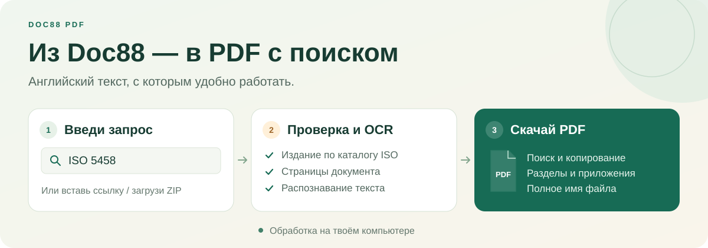

# 📄 DecliPDF

**Поиск стандартов и подготовка PDF с распознанным текстом.**

Локальная программа для Windows. Введите обозначение стандарта, выберите издание и получите PDF с поиском, копированием текста и структурой разделов. Интерфейс — на русском и английском.

  

### [⬇️ Скачать DecliPDF v1.9.0](https://github.com/decli-dot/doc88-local-pdf/releases/download/v1.9.0/doc88-local-pdf-v1.9.0.zip)

[Что нового](docs/RELEASE-v1.9.0.md) · [Инструкция локальной версии](docs/LOCAL.md) · [Сообщить о проблеме](https://github.com/decli-dot/doc88-local-pdf/issues)

## 🚀 Первый запуск

1. Установите **[Node.js 24](https://nodejs.org/en/download)**. Нужен Edge или Chrome.
2. Скачайте архив по кнопке выше и распакуйте в постоянную папку.
3. Откройте **`Setup.cmd`**, затем **`Start.cmd`**.

Программа откроется по адресу **http://127.0.0.1:8968/**. При первом OCR загрузится модель выбранного языка. Документы и результаты хранятся на вашем компьютере.

## 🔎 Как получить документ

1. Введите обозначение, например **`ISO 5458`**, **`DIN 129-1`** или **`ASME Y14.5`**.
2. Выберите издание, части серии и язык, если программа предложит выбор.
3. После обработки нажмите **«Скачать OCR PDF»**.

Для нескольких документов используйте вкладку **«Списком»**. Готовые PDF можно скачать одним ZIP. Дополнительные инструменты и сведения об источниках доступны в dev-режиме.

💡 Год можно не писать: программа предложит выбрать издание. Если потребуется подтверждение доступа, оно появится рядом с результатом.

## ✨ Что умеет программа

| Возможность                  | Что ты получишь                                                                                    |
| :--------------------------- | :------------------------------------------------------------------------------------------------- |
| 🔎 **Каталоги стандартов**   | ISO, DIN, BS, NF, EN и ASME. Проверка издания и полное официальное название файла.                 |
| 📑 **Проверка документа**    | Обозначение, выбранный язык, объём по каталогу, повторяющиеся страницы и явные пропуски нумерации. |
| 🔍 **Подготовка к OCR**      | Увеличение мелких и размытых страниц перед распознаванием. Исходные картинки сохраняются отдельно. |
| 🌿 **Структура PDF**         | Переходы к разделам, подразделам, приложениям и библиографии.                                      |
| 🔗 **Связанные документы**   | Поиск выбранных нормативных ссылок и отдельных поправок.                                           |
| ⏯️ **Очередь и продолжение** | Обработка списка, продолжение после сбоя и ZIP с готовыми PDF.                                     |

Язык выбирается по издателю и каталогу: **английский, немецкий или французский**; для ISO, ASME и BS — английский. Готовый текст извлекается из PDF, сканы проходят OCR. Сомнения в распознавании и нумерации показываются заметкой.

> **Новая капча Doc88:** автоматическое прохождение пока не подтверждено. При необходимости пройдите её вручную во встроенной панели. [Результаты проверки и настройки RuCaptcha](docs/CAPTCHA.md).

## 🔄 Как обновить

Закройте программу, замените файлы новой версией и снова откройте **`Setup.cmd`**, затем **`Start.cmd`**.

**Сохраните папку `.data`.** В ней находятся история, документы, настройки и данные продолжения заданий. Личные ключи и документы не входят в архив релиза.

🌐 Отдельная браузерная версия

На **[GitHub Pages](https://decli-dot.github.io/doc88-local-pdf/)** доступна браузерная версия с другим набором возможностей. Для поиска и получения страниц нужно **[расширение Chrome/Edge](extension/README.md)**; готовый ZIP можно обработать без него.

История этой версии хранится в браузере. Она не использует локальную папку `.data`.

## 📚 Если нужны подробности

- **[Полная инструкция](docs/LOCAL.md)** — поиск, проверки, настройки и решение типичных вопросов.
- **[Об установке расширения и его доступах](extension/README.md)** — для поиска ISO и получения страниц Doc88.
- **[Для разработчиков](CONTRIBUTING.md)** · [Что проверено](VALIDATION.md) · [История изменений](CHANGELOG.md).

Основано на [doc88-downloader](https://github.com/apankowski/doc88-downloader). Код программы — [MIT](LICENSE); исходный загрузчик и его лицензия сохранены в [vendor](vendor/). Программа не связана с Doc88. Используй её для документов, к которым у тебя есть законный доступ.
